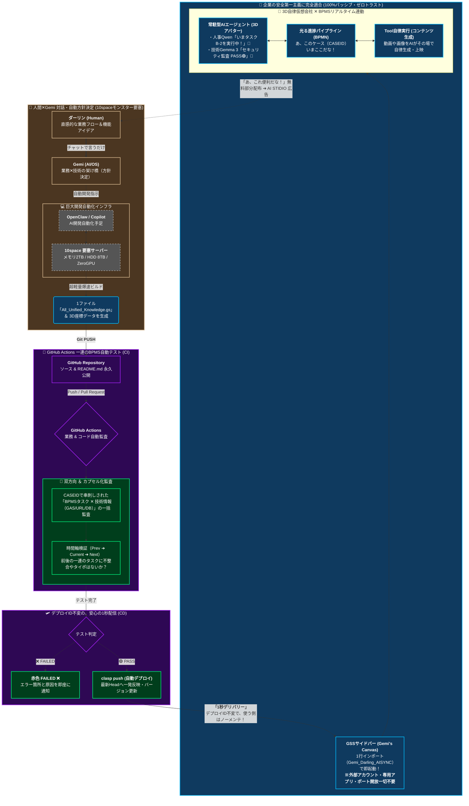

# Automa
<p>
  
  <a href="https://twitter.com/AutomaApp">
    
  </a>
  <a href="https://discord.gg/C6khwwTE84">
    
  </a>
</p>

An extension for automating your browser by connecting blocks. <br />
Auto-fill forms, do a repetitive task, take a screenshot, or scrape website data — the choice is yours. You can even schedule when the automation will execute!

## Downloads
<table cellspacing="0" cellpadding="0">
  <tr>
    <td valign="center">
      <a align="center" href="https://chrome.google.com/webstore/detail/automa/infppggnoaenmfagbfknfkancpbljcca">
        
        <p align="center">Chrome Web Store</p>
      </a>
    </td>
    <td valign="center">
      <a href="https://addons.mozilla.org/en-US/firefox/addon/automa/">
        
        <p align="center">Firefox Add-ons</p>
      </a>
    </td>
  </tr>
</table>

## Marketplace
Browse the Automa marketplace where you can share and download workflows with others. [Go to the marketplace &#187;](https://extension.automa.site/marketplace)

## Automa Chrome Extension Builder
Automa Chrome Extension Builder (Automa CEB for short) allows you to generate a standalone chrome extension based on Automa workflows. [Go to the documentation &#187;](https://docs.extension.automa.site/extension-builder)


## Project setup
Before running the `yarn dev` or `yarn build` script, you need to create the `getPassKey.js` file in the `src/utils` directory.  Inside the file write

```js
export default function() {
  return 'anything-you-want';
}
```

```bash
# Install dependencies
pnpm install

# Compiles and hot-reloads for development for the chrome browser
pnpm dev

# Compiles and minifies for production for the chrome browser
pnpm build

# Create a zip file from the build folder
pnpm build:zip

# Compiles and hot-reloads for development for the firefox browser
pnpm dev:firefox

# Compiles and minifies for production for the firefox browser
pnpm build:firefox

# Lints and fixes files
pnpm lint
```

### Icon Preview
v-remixicon/icons: https://preview-v-remixicon.vercel.app/

### Install Locally
#### Chrome
1. Open chrome and navigate to extensions page using this URL: chrome://extensions.
2. Enable the "Developer mode".
3. Click "Load unpacked extension" button, browse the `automa/build` directory and select it.


### Firefox
1. Open firefox and navigate to `about:debugging#/runtime/this-firefox`.
2. Click the "Load Temporary Add-on" button.
3. Browse the `automa/build` directory and select the `manifest.json` file.


## Contributors
Thanks to everyone who has submitted issues, made suggestions, and generally helped make this a better project.

<a href="https://github.com/AutomaApp/automa/graphs/contributors">
  
</a>

## License
Source code in this repository is variously licensed under the GNU Affero General Public License (AGPL), or the [Automa Commercial License](https://extension.automa.site/license/commercial/).

See [LICENSE.txt](./LICENSE.txt) for details.

## Human-AI Co-Creation Workflow


